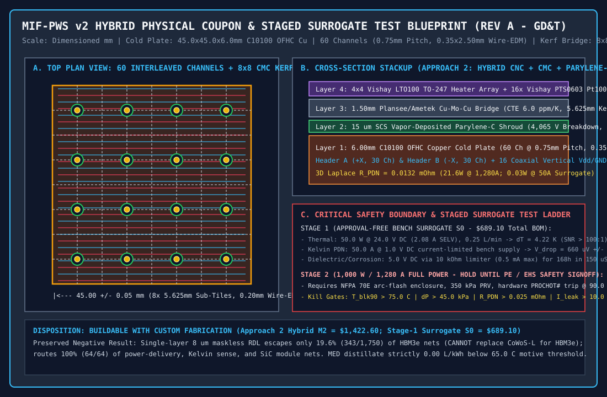

# Chip-package research: a proposed cooling and power-delivery design, independently challenged

**Status: computational research only. Hardware is on HOLD.**

A one-person AI-assisted team generated and independently challenged a
chip-package research hypothesis. Nothing here has been built. No hardware
has been fabricated, energized, or measured. Every number in this section
is a model output, not a measurement.

## What was investigated

Modern high-performance chips are assembled from small dies (chiplets)
mounted on a silicon interposer — a thin silicon layer that carries the
electrical connections between dies — inside a package with a lid and a
separate liquid cold plate on top. The proposal, called MIF-PWS v2,
asks whether those layers can be consolidated: power-delivery conductors,
finned liquid-coolant channels, high-density wiring for signal
redistribution and defect remapping, and structural support for the die,
all in one metal structure, deleting the separate interposer, lid, and
cold plate.

The question matters because packaging is a large share of the cost of
a high-performance compute module, and because power delivery and cooling
limit how much compute can be packed into one package. If consolidation
worked, it could cut cost and power loss. If it does not, the interesting
result is knowing exactly which assumption it depends on.

## The proposed design

*Proposed design — not physically built or tested.*

The drawing above is a concept illustration, not a fabrication drawing.
It shows a 45 × 45 mm plate with 60 interleaved coolant channels at
0.75 mm pitch, an 8 × 8 grid of kerf slots, and 16 coaxial posts. The
drawing itself contains labels the independent audit found to be wrong
(see [LIMITATIONS.md](LIMITATIONS.md)); it is published unchanged so
readers can see what was claimed, with the corrections stated next to it.

A smaller coupon version — a single test piece for one cooling path and
one electrical-resistance measurement — is in
`figures/mif_pws_v2_coupon_blueprint.svg`. It is already labeled
model-only and not physically fabricated.

## What the simulations showed

A tournament model compared the proposed design against a conventional
design (chiplets on a commercial interposer with a lidded split-flow
cold plate) at a modeled scale of 2,500 units, scoring each design in
teraflops of compute per dollar of five-year lifecycle cost
(TFLOPS per 5-year dollar).

| Design (as modeled) | Score | Five-year cost per module | Peak junction temperature |
| --- | --- | --- | --- |
| Conventional, as configured | 1.5540 | $11,011 | 108.2 °C |
| Conventional, given the same 0.75 mm cooling geometry | 1.8671 | $10,490 | 82.4 °C |
| Existing direct-to-silicon control | 1.6945 | $11,565 | 81.3 °C |
| Proposed design, as configured | 3.0571 | $6,479 | 60.3 °C |
| Proposed design, power-delivery advantage removed | 2.7099 | $7,243 | 65.0 °C |
| Proposed design, cost advantage removed | 2.1733 | $9,114 | 60.3 °C |
| Proposed design, both advantages removed | 1.9871 | $9,878 | 65.0 °C |

The headline number — 3.0571 against 1.5540, a nearly twofold modeled
advantage — depends on the proposed design's own assumptions. Give the
conventional design the same cooling geometry and the gap shrinks to
3.0571 against 1.8671. Remove the proposed design's assumed
power-delivery and cost advantages as well, and the score falls to
1.9871. Equalize the assigned manufacturing yield and the amortized
tooling cost too, and it falls to 1.8733 against 1.8671 for the matched
conventional design: **+0.332%, effectively parity**. The modeled
advantage is therefore conditional on several values that have not been
measured. The full comparison, including the severe operating case and
the parity calculation, is in [REPRODUCE.md](REPRODUCE.md) and is
reproducible with one command.

Two further results are worth stating plainly:

- **The proposed design cannot replace a commercial interposer for
  high-bandwidth memory.** A single-layer 8 µm-pitch wiring layer routes
  343 of 1,750 synthetic HBM3e (high-bandwidth memory) connections
  (19.6%); 1,407 go unrouted. That figure comes from a closed-form
  escape calculation — the 5.5 mm die edge divided by the pitch, times
  an efficiency factor — not from routing a real netlist. A commercial
  interposer uses sub-micron wiring or six layers at 2 µm pitch. The
  proposed design's valid domain, if any, is coarse power and thermal
  work, not fine-pitch signal routing.
- **A physically coherent alternative survives.** Keeping the proven
  signal interposer and changing only the back side — integrated cooling
  plus power delivery — scores 1.8142 against a matched conventional
  1.8637 (−2.7%). With an assumed (not demonstrated) low-resistance
  power delivery it scores 1.9148 (+2.7%); with an assumed yield
  improvement it scores 2.2019 (+18.2%). That is a research direction,
  not a result.

## What the independent challenge found wrong

An independent review of the physical experiment package found eight
defects, summarized here and in full in [LIMITATIONS.md](LIMITATIONS.md):

1. **The electrical test design would draw 614.4 W, not 50 W.** Sixteen
   15-ohm heaters wired in parallel at 24 V draw 38.4 W each.
   The test fixture was described as a 50 W surrogate.
2. **Sixteen power-transistor packages do not fit the stated 45 mm
   face.** Each is 15.76 mm wide; four across need 63.04 mm.
3. **The STEP files are not manufacturable solids.** They are text
   wrappers containing reference points (139 in the cold plate), with no
   solid body, closed shell, or faces.
4. **The coolant flow numbers are inconsistent.** The model counts 60
   passes per header; the physical drawing has 30 channels per header.
   Modeled velocity 0.397 m/s against 0.794 m/s by continuity; modeled
   channel length 22.5 mm against about 42 mm drawn.
5. **The claimed three-dimensional power-delivery solver is a
   two-dimensional 16 × 16 lumped network.** It has no nodes in the
   third dimension.
6. **The evidence signing key is derivable from a fixed literal seed in
   the public source.** The signatures prove the file was reproduced,
   not that an independent witness checked it.
7. **The desalination receipt conflicts with the numerical output.**
   The receipt claims 2.753 and 6.809 liters per kilowatt-hour at 69 °C
   and 85 °C; the solver returns 5.803 and 8.459. No desalination has
   been demonstrated. **The freshwater-production claim is not
   established and is not presented here as a demonstrated benefit.**
8. **"Approval-free 50 A" is not an acceptable safety classification**
   for energized testing at 1,000 W and 1,280 A.

Because of these findings, the hardware is on HOLD. The step-by-step
manufacturing and test instructions are withheld. What is published is
a read-only computational snapshot: the models, the falsification
results, and the audit, so anyone can check the arithmetic and challenge
the assumptions.

## What is in this section

- `README.md` — this file.
- `REPRODUCE.md` — how to reproduce every number with one command, and
  what each result means.
- `LIMITATIONS.md` — the full feasibility findings, the remaining
  uncertainty, and what would have to change before any hardware work.
- `CONTRIBUTING.md` — how to extend the research or submit a correction.
- `SOURCES.md` — where every file came from, its hash, what was adapted,
  and what was excluded and why.
- `figures/` — the results charts and the concept illustrations.
- `simulation/` — the runnable models, the independent challenge
  scripts, the itemized bill of materials, and the expected results.
- `cad/` — the CAD files as unqualified research artifacts, with the
  audit's findings stated next to them.
- `evidence/` — the independent acceptance report, the independent
  review, the repair-round analysis, and the defective heater netlist
  published as evidence of the 614.4 W error.

## How to use this research

- **To check the numbers:** follow [REPRODUCE.md](REPRODUCE.md). A
  standard computer and a Python virtual environment are enough. No
  private access, no paid service, and no contact with the author is
  needed.
- **To challenge it:** see [CONTRIBUTING.md](CONTRIBUTING.md). The most
  useful contributions are a measured yield, a solved three-dimensional
  power-delivery resistance, a routed netlist, or a quoted fabrication
  cost — the four values the modeled advantage depends on.
- **To build it:** do not. The hardware is on HOLD, the electrical test
  design is wrong by a factor of twelve, and the drawings are not
  manufacturable. Any future hardware work needs a corrected electrical
  design, a real solid model, a licensed professional engineer, and an
  environmental health and safety review first.
